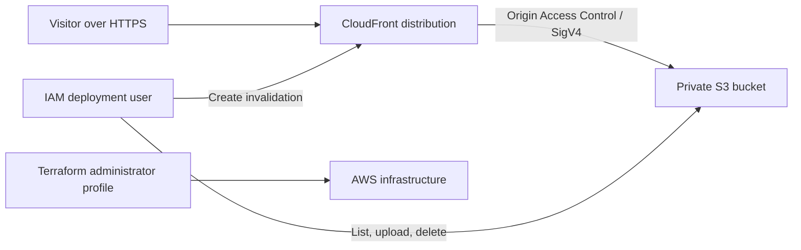

# aws-static-portfolio-terraform

Deploy a responsive static portfolio to a private Amazon S3 bucket and serve it securely through CloudFront. Terraform provisions the infrastructure and a dedicated, least-privilege IAM deployment user.

## Architecture



The bucket blocks all public access. CloudFront uses Origin Access Control (OAC) to read site objects; visitors never access S3 directly. The deployment user can change only this site's objects and invalidate only this distribution.

## Prerequisites

- WSL 2 with a Linux distribution such as Ubuntu.
- An AWS account and AWS CLI v2 installed inside WSL.
- Terraform 1.5 or later installed inside WSL.
- An AWS CLI profile with permission to manage the resources in `main.tf`, including S3, CloudFront, IAM users and policies, and `sts:GetCallerIdentity`. Use a temporary or federated administrator session where possible; do not use root credentials.
- Run the commands below from a WSL terminal at the repository root. AWS CLI profiles configured in Windows are separate from WSL; configure the profiles you need inside WSL.

Install Terraform and AWS CLI in your WSL distribution before continuing. If the repository is on your Windows drive, enter it from WSL with `cd "/mnt/c/Users/HP PC/Desktop/aws-static-portfolio-terraform"`. For best performance, consider keeping the repository in the WSL filesystem.

CloudFront distributions can incur charges. Check current AWS pricing and set account billing alerts before deploying.

## Configure

1. Copy the example variables file and choose an S3 bucket name that is globally unique:

   ```bash
   cp terraform.tfvars.example terraform.tfvars
   ```

2. Edit `terraform.tfvars` with a text editor such as `nano terraform.tfvars`:

   ```hcl
   aws_region       = "us-east-1"
   bucket_name      = "static-portfolio-123456789012"
   deploy_user_name = "portfolio-deploy"
   ```

   Replace `123456789012` with your 12-digit AWS account ID (get it with `aws sts get-caller-identity --query Account --output text`). S3 bucket names are globally unique across AWS and must be lowercase. If the account-specific name is also taken, add a short unique suffix. `terraform.tfvars` is ignored by Git.

3. Initialize and review the plan using the profile that is allowed to create infrastructure:

   ```bash
   export AWS_PROFILE="your-admin-profile"
   terraform init
   terraform fmt -check
   terraform validate
   terraform plan
   ```

4. Provision the infrastructure:

   ```bash
   terraform apply
   ```

   Review the plan before confirming. If S3 reports `BucketAlreadyExists`, choose a different globally unique `bucket_name` in `terraform.tfvars` and run `terraform apply` again. CloudFront creation and updates can take several minutes. Terraform outputs the bucket name, distribution ID, URL, and deploy IAM username.

## Create deployment credentials

Terraform creates the dedicated IAM user and scoped policy but does not create access keys or store credentials in Terraform state.

1. In the AWS console, switch to the administrator role/profile used for Terraform and open IAM.
2. Select the `deploy_user_name` output user, create an access key for **Command Line Interface (CLI)** use, and securely copy the secret access key. It is shown only once.
3. Configure a named AWS CLI profile on your computer:

   ```bash
   aws configure --profile portfolio-deploy
   ```

   Enter the new access key, secret key, and region. Never commit credentials, put them in `terraform.tfvars`, or paste them into logs.

## Deploy

Before publishing, personalize `site/index.html` and `site/404.html`: replace `Your Name`, the `YN` initials, and `hello@example.com`, and update the project descriptions and contact links. Then run this from the repository root in WSL:

```bash
bash ./scripts/deploy.sh
```

The script syncs the site (including deletions) and requests a CloudFront invalidation. It defaults to the `portfolio-deploy` AWS profile. To use another named profile, pass its name as an argument:

```bash
bash ./scripts/deploy.sh another-profile
```

Once CloudFront finishes deploying, visit the `site_url` Terraform output.

## IAM permissions

The generated IAM policy grants:

- `s3:ListBucket` on the one site bucket.
- `s3:PutObject` and `s3:DeleteObject` on that bucket's objects, needed to upload and mirror the site.
- `cloudfront:CreateInvalidation` on the one CloudFront distribution.

It does not grant public access, bucket configuration changes, access to other buckets, or general CloudFront administration. Use the administrator profile only for Terraform infrastructure changes.

## Cleanup

First remove the uploaded objects, then destroy the infrastructure using the same administrator profile used to create it:

```bash
export AWS_PROFILE="your-admin-profile"
bucket="$(terraform output -raw bucket_name)"
aws s3 rm "s3://${bucket}" --recursive
terraform destroy
```

Terraform waits for CloudFront changes while deleting the distribution. The dedicated IAM deployment user is configured for Terraform to remove its access keys when destroyed. Delete local credentials from the `portfolio-deploy` AWS CLI profile when you no longer need them.

## Project structure

```text
.
├── .gitignore
├── .terraform.lock.hcl
├── README.md
├── main.tf
├── outputs.tf
├── variables.tf
├── terraform.tfvars.example
├── scripts/
│   ├── deploy.sh
│   └── deploy.ps1
└── site/
    ├── index.html
    ├── 404.html
    ├── styles.css
    └── script.js
```
